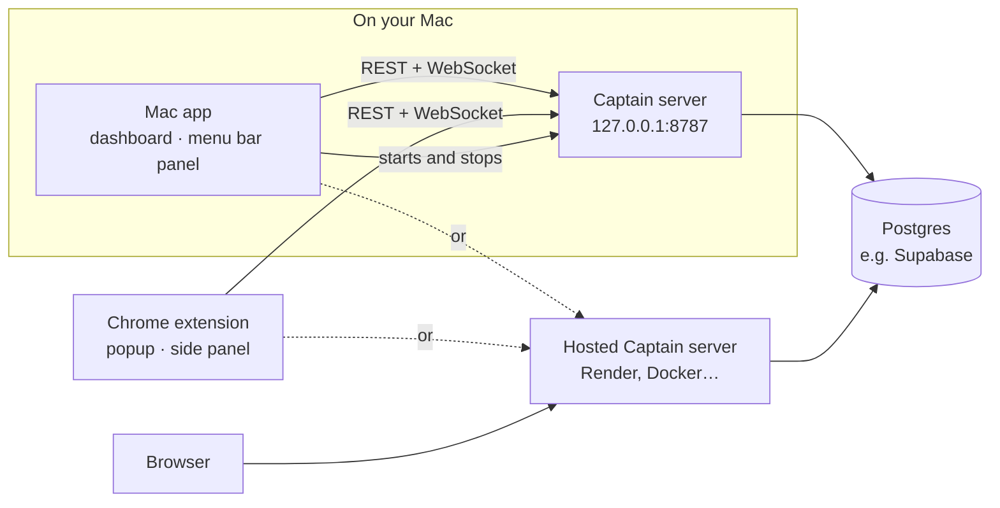
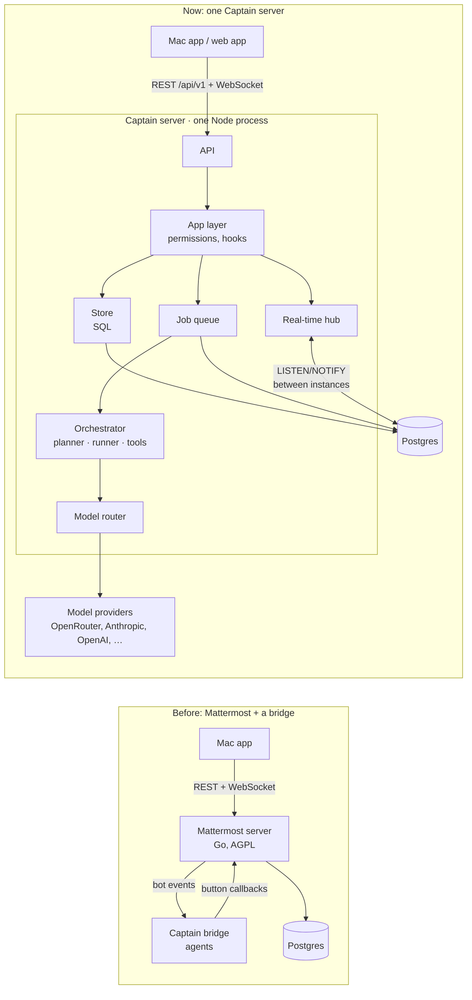
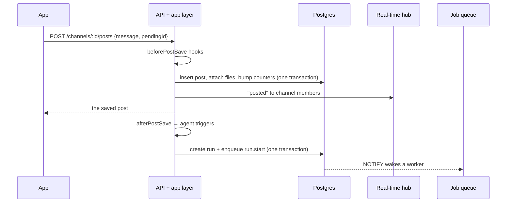
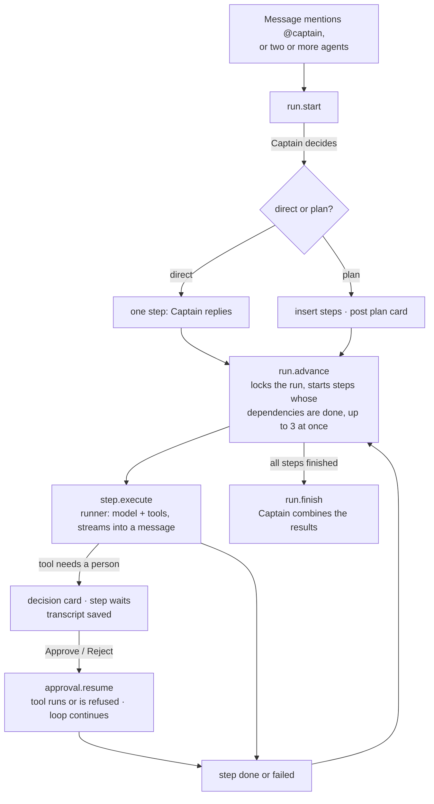
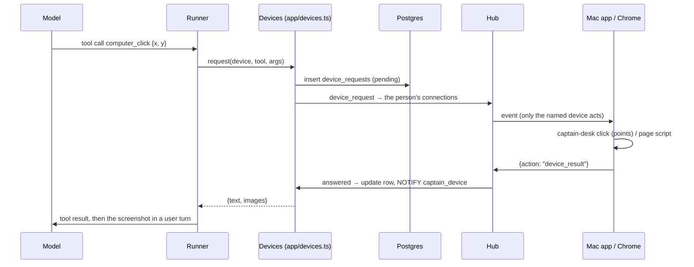

# Architecture

Captain is one server and one app.

- **The server** (`server/`) is a TypeScript service on Postgres. It handles accounts, workspaces, chat, real-time updates, model routing and multi-agent orchestration. It runs hosted, or inside the Mac app.
- **The app** (`desktop/`) is React, and runs in three places:
  - **The Mac app (Tauri).** It adds the menu bar panel, the global shortcut, screen snapshots, banners and the saved session. It can also start the server on the Mac: the code ships in the app's Resources and runs with the Mac's Node.js on 127.0.0.1:8787 (`src-tauri/src/lib.rs`, "built-in server").
  - **The web app** the server hosts at `/`.
  - **The Chrome extension** (`src/extension/`). It shows the menu bar panel's view in the toolbar popup and the side panel, and adds page tools, a right-click menu and a badge from a background worker.

Both servers can share one database: they're then two instances of the same Captain, and real-time events pass between them through Postgres.

The server copies how Mattermost is built: its layers, its real-time protocol, and the way it treats bots and message hooks. It uses none of Mattermost's code.

## Before and after

## The Mattermost ideas we copied

| Mattermost | Captain | Where |
| --- | --- | --- |
| Layers: `api4` → `app` → `store` | Same three layers. Routes only parse input, the app layer checks permissions and runs the logic, and the store holds the SQL. | `src/api/`, `src/app/`, `src/store/` |
| Numbered SQL migrations with a ledger | `0001_init.sql` and up. They're applied at startup under an advisory lock, and checksums stop anyone from editing an applied migration. | `src/db/migrate.ts` |
| Retrying serialization and deadlock errors | `tx()` retries on 40001 and 40P01. | `src/db/index.ts` |
| 26-character ids, millisecond timestamps, soft deletes | Same. | `src/util/ids.ts` |
| WebSocket: authenticate with the first message, sequence numbers, reconnect with `connection_id` and `sequence_number` for a lossless replay | Same. The last 256 events are kept for 2 minutes. Typing and streaming text are "droppable": a slow client skips them, and they're never replayed. | `src/realtime/hub.ts`, `desktop/src/lib/socket.ts` |
| Cluster messages between servers | Postgres `LISTEN/NOTIFY`, with an outbox table for payloads larger than 7 KB. | `src/realtime/cluster.ts` |
| Bots are users | Each agent has a bot account (`is_bot`) that's a workspace member. Agents can be mentioned, messaged, and added to channels like people. | `src/agents/builtins.ts` |
| Plugin hooks `MessageWillBePosted` / `MessageHasBeenPosted` | `beforePostSave` (rewrite or reject) and `afterPostSave` (fire-and-forget; this is where agents start). | `src/app/hooks.ts` |
| Interactive message buttons (post actions) | `POST /posts/:id/actions/:action`, handled by post type. Decision cards use it. | `src/app/posts.ts` → `action` |
| Unread counts on the channel membership (`msg_count`, `mention_count`) | Same. Badges never count posts. | `src/store/channels.ts` → `recordPost` |
| `pending_post_id` for optimistic sends | `pendingId`, echoed back so the app swaps in the real message. | `src/app/posts.ts`, `desktop/src/lib/send.ts` |
| Jobs server | A Postgres job queue: `FOR UPDATE SKIP LOCKED`, leases with heartbeats, retries with backoff, dedupe keys, NOTIFY wake-ups. | `src/jobs/queue.ts` |
| Teams | Workspaces, with roles owner / admin / member / guest and invite links. | `src/app/workspaces.ts` |

## What a message does

## A run, start to finish

Every agent task is a **run**, and every run has **steps**. A plain reply is a run with one step, so pausing for approval, stopping and resuming work the same way everywhere.

- **Planner** (`agents/planner.ts`): Captain answers in JSON, either `{"mode":"direct"}` or a list of steps with `dependsOn`. The plan is checked before it runs: known agents only, unique ids, dependencies that exist, and no cycles. If planning fails, Captain answers directly.
- **Teams** (`agents/triggers.ts`): a message naming two or more agents starts one run led by Captain, with the named agents saved on the run (`runs.team`). Captain plans with only them, every one of them gets at least one step, and if planning fails each gets the request as a step of its own (`namedPlan`). Replies in the thread reuse the team. The plan card lists them (`coordinating`).
- **Runner** (`agents/runner.ts`): calls the router and streams text to the chat as droppable `post_stream` events, at most every 120 ms. It runs tools and feeds their results back to the model. An *external* tool (email, `request_approval`) makes it stop, post a decision card, and return its transcript. The transcript is saved on the step, so the work picks up exactly where it stopped.
- **Context** (`agents/history.ts`): the thread, the recent DM, or recent channel messages as background, plus images and text files. Agents read only what the person who asked can read.
- **Jobs**: each phase is a durable job. If a server dies mid-step, its lease runs out and another server reruns the step. The half-written message is marked as interrupted.

## Devices: agents on your Mac and in your Chrome

A **device** is the Mac app or the Chrome extension, registered over the socket it already holds (`{action: "device_register"}` after `hello`; the hub answers with the device's id, which the device keeps). While one is online, `agents/tools/device.ts` gives agents working for that person `computer_*` tools (a Mac) or `browser_*` tools (Chrome), limited to the capabilities the device announced.

- **One at a time.** Requests to a device are queued per device (one mouse), each with a timeout (30 s; 45–60 s for looking, typing and opening). Stopping the run aborts the tool's signal, which marks the request cancelled.
- **Across servers.** The request is a row; the device answers over its socket to whichever server holds it (or over HTTP between reconnects); that server updates the row and `NOTIFY`s, and the waiting tool (which also polls) picks it up.
- **Asking once.** `needsApproval` on every device tool is true until the person approves the first one in the run (a `device_grants` row) or the device is on autopilot. The approval card names the agent and the device and says Esc stops it.
- **Screens.** A `ToolResult` can carry `images` (data URLs). The runner shows them to the model in a user turn right after the tool results (tool messages can only be text), marks the step as needing a vision model, keeps only the last three screenshots in the conversation, and leaves them out of saved transcripts. Steps that have device tools get `AGENT_MAX_COMPUTER_ROUNDS` tool rounds instead of `AGENT_MAX_TOOL_ROUNDS`. The system prompt gets a guide (`prompts.ts` → `deviceGuide`) on how to look, act and check, when to ask, and what never to do.
- **On the Mac.** The dashboard window (`src/lib/device.ts`) carries out each request with `src/lib/computer.ts`, which calls the `captain-desk` helper (`src-tauri/desk/main.swift`) through `desk_run` in `lib.rs`: screenshots without Captain's own windows, a region close-up, the Accessibility tree of the app in front (with positions), clicks, drags, scrolls, keys, Unicode typing, opening and focusing apps, the clipboard. The model works in the pixels of its latest screenshot (at most 1440 wide); `computer.ts` converts to screen points and back. The orb shows each step (`device-activity`) and Esc (`drive_escape`) or Stop ends the run.
- **In Chrome.** The background worker (`src/extension/background.ts`) keeps the socket while "Let agents use this Chrome" is on and does each request with `src/extension/browser.ts`: a page snapshot gives every link, button and field an id (`e12`) kept in the page's isolated world; clicks dispatch the pointer/mouse/click sequence on the element; typing uses `execCommand('insertText')` (works in rich editors) with a native-setter fallback; keys go through Chrome's debugger when granted, else DOM events (Enter submits a form).

## Model router

`llm/router.ts`, `llm/catalog.ts`, `config/models.json`, following Captain's Smart Router:

1. **Tier.** Each call gets a tier: easy, balanced or hard. An agent's own tier is the floor (Analyst is "hard"), and "auto" lets the request decide. Heuristics in `llm/classify.ts` raise the tier for long or demanding requests. A cheap-model classifier is optional.
2. **Candidates.** The router lists the tier's models by priority, then lower tiers, then higher ones. It keeps only models that can see images when images are attached, and that support tools when tools are offered. A model pinned on the agent goes first.
3. **Routes.** Each model has provider routes in order: the vendor, then OpenRouter, then a gateway. A route is used only if its provider has a key. Keys come from Settings (`llm/keys.ts`: encrypted in `provider_keys`, reloaded on every instance through `NOTIFY captain_keys`) or else from the environment. A model and provider pair that fails 3 times is skipped for 2 minutes; changing a provider's key clears that.
4. **Limits.** Every call asks for a bounded answer (`LLM_MAX_OUTPUT_TOKENS`, 4,000; plans 1,500). A "not enough credit" refusal (OpenRouter's 402, "can only afford N") is retried asking for less, and that provider's calls ask for no more for 10 minutes. A 429 waits (honoring `Retry-After`) and retries the same route; rate limits don't count against the breaker. Each provider gets at most `LLM_MAX_CONCURRENT_PER_PROVIDER` (4) calls at once on each instance.
5. **Ledger.** Every attempt is written to `usage_events` with tokens, cost, latency and the run and step. If a workspace is over its monthly budget, the call is refused with a 402 before any model is called.
6. **Demo.** With no key configured, a built-in demo model answers. It follows the same protocol, including streaming, tool calls and plan JSON.

All providers are called with the OpenAI-compatible `/chat/completions` format and streaming server-sent events (`llm/client.ts`).

## Data

Tables, created by the numbered files in `src/db/migrations/`:

- people and access: `users` (`instance_admin` marks who runs the server), `sessions`, `password_resets`, `workspaces`, `workspace_members`, `invites`
- chat: `channels`, `channel_members`, `posts` (with a generated full-text `search` column), `reactions`, `files`
- agents: `agents`, `runs`, `run_steps`, `approvals`
- devices: `devices`, `device_requests`, `device_grants`
- models: `usage_events`, `provider_keys` (encrypted keys pasted in Settings)
- infrastructure: `jobs`, `realtime_outbox`, `audit_log`

After migrating, the server turns on row-level security for every table in `public`, with no policies. On Supabase this keeps the Data API from serving them; the server itself connects as the tables' owner and isn't affected.

Special message types:

- `plan`: a plan card, with `props.plan`
- `decision`: a decision card, with `props.decision`
- `agent_step`: a step's output, with `props.step`

Agent messages carry `props.model` (the model id, provider, tier and cost) and, while they're being written, `props.streaming`.

## The app

- `desktop/src/lib/api.ts` handles REST calls.
- `socket.ts` manages the WebSocket: authentication, replay, and a resync when replay isn't possible.
- `store.ts` is one Zustand store per window.
- Home (`src/dashboard/Overview.tsx`) is a dashboard from `GET /workspaces/:id/dashboard` (`server/src/app/dashboard.ts`): runs in progress and finished in channels you're in, with tokens per run from `usage_events`, and for admins the token totals and a 14-day series in your time zone (the app sends its UTC offset). It refetches when a `run_updated` event arrives and every 30 seconds.
- `realtime.ts` applies events, raises banners and sets the badge. In the Mac app, the dashboard window owns the only socket and relays its events to the panel window.
- The Rust core (`desktop/src-tauri/src/lib.rs`) handles everything native:
  - the menu bar icon and its badge
  - two global shortcuts (the panel; talk to Captain), changeable in Settings → This Mac
  - the floating Captain (`orb.html`, `src/orb/`): the dashboard window feeds it what needs you and the chats and agents it can route to, posts what you say (`src/lib/talk.ts`, routing in `src/lib/route.ts`) and reports the plan's steps and the answer back; voice typing goes through the helper (`frontapp`, `paste`)
  - voice: the `captain-voice` helper (`src-tauri/voice/main.swift`) uses Apple's speech recognition to listen and Apple's voices to speak
  - the frosted panel under the icon
  - `screencapture` snapshots
  - notification banners that open the right thread
  - the session and the built-in server's database address, in a file only you can read (`secrets.json` in the app's settings folder)
  - `desk_run`: one call to the `captain-desk` helper, for agents working on this Mac (see Devices)

## Scaling and availability

- **More users:** run more copies of the server behind a load balancer. WebSockets don't need sticky sessions, because events reach every instance over NOTIFY. Each instance also runs agent workers; `WORKER_CONCURRENCY` sets how many jobs each one takes.
- **Agents slowing the API down:** run the same image twice, once with `WORKERS=false` (API only) and once as a workers-only service with no public port.
- **A server dies:** its WebSocket clients reconnect to another instance. Within 2 minutes, a client on the same instance gets a replay; otherwise it reloads its state. Its jobs' leases expire after 90 seconds, and another instance takes them over.
- **Limits worth knowing:**
  - The rate limiter and the circuit breaker live in memory on each instance.
  - Uploads live on a disk. Move them to S3 before running more than one instance, or mount shared storage.
